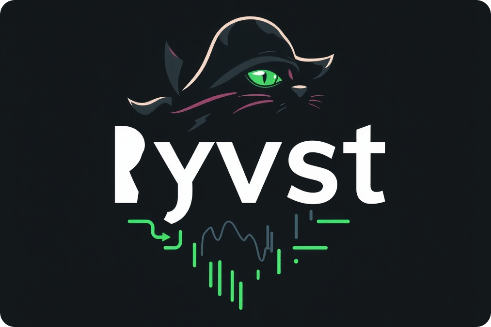

<p align="center">

</p>

<h1 align="center"></h1>
<div align="center" style="margin-top: 2rem;">
<p>
<a href="https://github.com/szorfein/ryvst/stargazers"><a>&nbsp;&nbsp;
<a href="https://github.com/szorfein/ryvst/"></a>&nbsp;&nbsp;
<a href="https://github.com/szorfein/ryvst/commits/main/"></a>&nbsp;&nbsp;
<a href="https://github.com/szorfein/ryvst/blob/main/LICENSE"></a>&nbsp;&nbsp;
</p>

A download manager for your dotfiles, declare your need in YAML.

This is a rewrite of [Reaver](https://github.com/szorfein/reaver) from Ruby to Go.

</div>

## Development

- Alpha, (current stage)
- Beta
- First Release

## Features

- Downloads files very fast via Goroutine
- Uncompress Archive ZIP, soon TAR
- Time now support Second, Minute and Hour
- Support Git (only `git clone`, `git pull`) and you need to install it.

## Use from source

```sh
git clone https://github.com/szorfein/ryvst
cd ryvst
go build -o ryvst cmd/ryvst/main.go
```

## Examples

#### Need ohmyzsh?

[ohmyzsh](https://github.com/ohmyzsh) can be installed in `$HOME/.ohmyzsh`, plugins in `$HOME/.ohmyzsh/custom/plugins`, so create a new collections `zsh.yml`:

    $EDITOR ~/.config/ryvst/zsh.yml

```yml
every_time: 24h
tasks:
  - name: ohmyzsh.zip
    url: https://github.com/ohmyzsh/ohmyzsh/archive/refs/heads/master.zip
    to_dest: .ohmyzsh
  - name: zsh-autosuggestions.tar.gz
    url: https://github.com/zsh-users/zsh-autosuggestions/archive/refs/heads/master.tar.gz
    to_dest: .ohmyzsh/custom/plugins/zsh-autosuggestions
  - name: zsh-syntax-highlighting.tar.gz
    url: https://github.com/zsh-users/zsh-syntax-highlighting/archive/refs/heads/master.tar.gz
    to_dest: .ohmyzsh/custom/plugins/zsh-syntax-highlighting
```

`to_dest` is relative to `$HOME`, `name` is the name of the file after the download. All the files are extracted/moved in the given order, so place `ohmyzsh` first.

#### Something with Git?

If you own a git repository, you may prefer to use Git instead of an archive.

    $EDITOR ~/.config/ryvst/neovim.yml

```yml
every_time: 12h
tasks:
  - url: https://github.com/szorfein/vie.git
    to_dest: .config/nvim
```

You don't need to use `name` and the `url` should end with `.git`

#### Look into /examples

The [examples](https://github.com/szorfein/ryvst/tree/main/examples) should be enought to start writing your own files collection. ohmyzsh, tmux, neovim...
